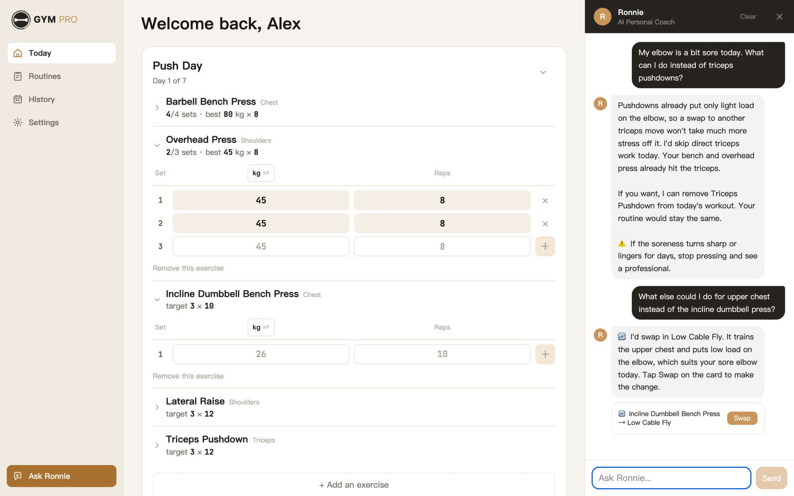
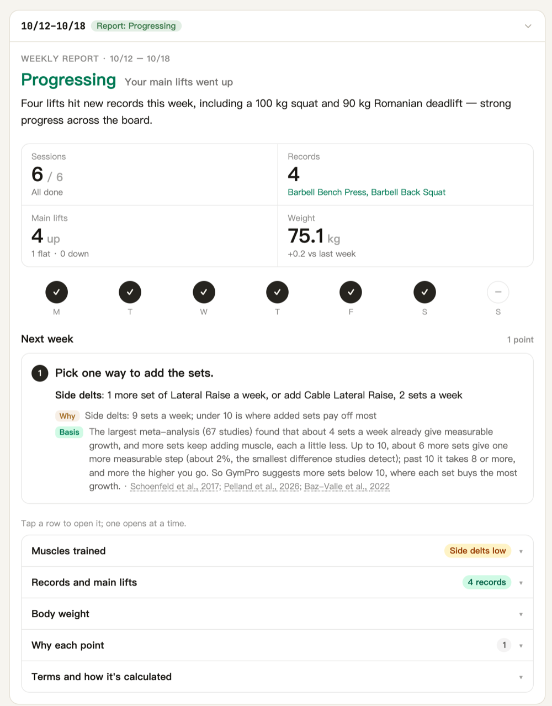
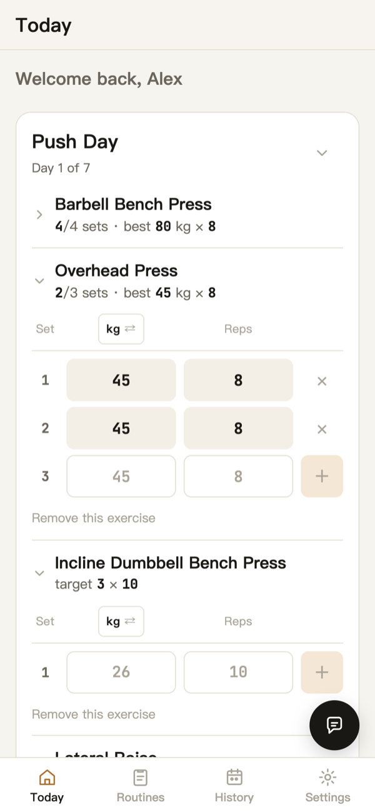
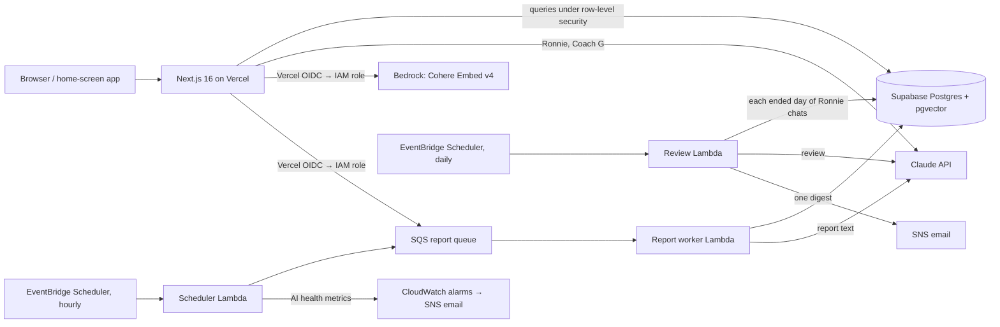

# GymPro

A workout tracker with an AI coach, in English and Traditional Chinese. It has three AI features, and an eval suite decides what ships in each:

- **Ronnie**: a coaching agent that works on the user's own training data.
- **Coach G**: a routine planner.
- **The weekly report**: a training review.

**Live:** [gympro.chichi.mom](https://gympro.chichi.mom). I log every workout in it.



## Highlights

- **An agent with guardrails.** Ronnie is a Claude tool-use agent with 13 tools over the user's data and a knowledge base of 149 papers.
  - Reads are free. A change to today's workout that the user names is made at once. A change Ronnie picks, and any change to a routine, is shown as a card, and code applies it when the user taps it.
  - Code writes every line that states a fact: memory receipts, plan summaries, corrections.
  - A reply that contradicts today's log is caught before it's shown.
- **Evals decide what ships.**
  - 71 scripted conversations against a fixture user, plus 71 search queries and 36 report scenarios.
  - Graded by code checks and an LLM judge.
  - Every run is recorded in the repo, and the model for each feature was chosen by eval.
  - Mistakes found in evals are replayed in CI on every pull request, at no cost.
- **Facts in code, words from the model.**
  - The weekly report's numbers and advice come from a rule table in code, backed by 22 cited papers whose DOIs are checked in CI. Code writes what to do next session on each lift; the model only phrases the rest.
  - Coach G's plan is built by code; a small model only reads the user's free text.
- **Production infrastructure in Terraform.**
  - Vercel and Supabase, with AWS for the report pipeline: SQS, Lambda and EventBridge Scheduler.
  - No long-lived AWS keys.
  - 12 CloudWatch alarms. Every AI call is traced with its tokens and cost.

## What it does

| | |
|---|---|
| **Log** | One set table for strength and cardio, with 8 log types: weight × reps, bodyweight plus added weight, assisted, timed, treadmill, machine level, rower, time only. Units are per exercise (kg or lb, km or mi). There is also a daily note and body weight. |
| **Ronnie** | A chat coach. *"My elbow hurts, what instead of pushdowns?"*, *"What's left today?"*, *"Plan me a 4-day week."*, *"Will creatine make my hair fall out?"* It remembers injuries, likes and dislikes, equipment and schedule across conversations, and answers fitness questions from research notes, with the papers listed under the reply. |
| **Coach G** | The user answers a few questions and gets a week of routines built from a 155-exercise library, rated for muscles and joint load. |
| **Weekly report** | Generated when the user's training period ends, in their time zone. It shows the status, the goal's progress, the key numbers and follow-up on last period's advice. Then it says what to do next session: for each lift the goal names, the way the user trains it now and other ways research supports; one line for each other main lift; and an action for each rule that fired. Each piece names its data, where that came from (the log, the goal, Ronnie's notes, what the user said) and the research behind it. |
| **Layouts** | Separate phone and desktop layouts. On iPhone it installs to the home screen. |

<p>
  
  &nbsp;
  
</p>

The screenshots are from a demo account with made-up training ([`supabase/seed/demo_account.sql`](supabase/seed/demo_account.sql)). The report and Ronnie's replies in them are real model output.

## Architecture



- **App:** Next.js 16 (App Router, server actions and route handlers) on Vercel. The UI strings are in English and Traditional Chinese, using next-intl.
- **Data:** Supabase Postgres, with row-level security on every user table. The policies are in the repo. pgvector holds the exercise embeddings.
- **Reports:** an hourly scheduler finds the users whose period has ended in their own time zone, claims a report row, and queues it. The worker Lambda builds and writes the report. A request is retried up to 3 times, then goes to a dead-letter queue, which raises an alarm.
- **AWS access:** Vercel deployments assume IAM roles through OIDC, with separate roles for production and preview. API keys live in SSM Parameter Store. Everything AWS-side is in [`infra/terraform`](infra/terraform).

## How the AI parts are built

### Ronnie, an agent

[`lib/ronnie`](lib/ronnie): Claude Sonnet 5.5 in a tool-use loop.

| Tools | |
|---|---|
| Read | `get_today_workout`, `get_workout_history`, `get_training_summary`, `get_routine_exercises`, `search_exercises`, `search_knowledge` |
| Change today | `add_exercise_today`, `remove_exercise_today`, `recommend_exercise` (a swap card) |
| Change routines | `propose_routine_change`, `plan_routines` (a plan card, built by Coach G's planner) |
| Memory | `remember`, `forget` |

- **Who decides a change.** A change to today's workout that the user names, Ronnie makes at once. A change Ronnie picks, and any change to a routine, is shown as a card, and code applies it after the tap. Removing an exercise from a routine asks twice. The model never makes a permanent change itself; that is enforced by code, not by the prompt.
- **Research notes.** [`lib/ronnie/knowledge-notes.json`](lib/ronnie/knowledge-notes.json) holds one note per paper, 149 in all. Each was written from the paper's abstract and checked against it, and each DOI was resolved through LibKey. Search ranks the notes by Cohere vectors in pgvector.
  - **Citations:** Ronnie marks a sentence with a note's key. Code turns the keys into the papers listed under the reply, so a source shown is always one Ronnie was given. A key it wasn't given is dropped. The chat shows the list as one line ("See 3 sources") that opens it, with no number after each tip.
  - **Check:** before the reply is shown, Claude Haiku reads it against the notes. A finding presented as research that no note supports, or that goes past its note, is sent back once for a rewrite.
  - **No note:** general advice that no note covers stays in the reply, with a line under it saying it has no research source. Code adds that line to any reply that searched the notes and cites none.
- **Memory.** The kinds the code acts on have fixed slots:
  - one injury per joint, active or resolved;
  - a like or dislike per exercise;
  - equipment;
  - schedule.

  A new fact replaces the old one in code. Everything else goes into up to 30 free-text notes. The "saved" line under a reply is written by code from what was actually stored.
- **Reply check.** Before a reply is shown, code reads it clause by clause. It looks for a claim that an exercise was done while today's log has no sets of it.
  - If it finds one, the model rewrites the reply once, without tools.
  - If the claim survives, a correction in the code's words is added.

  This took the case that kept failing from 5/8 to 8/8 passing ([#62](https://github.com/Yung-Chi-Wu/gympro/pull/62)).
- **Exercise search.** Keyword ranking, with plurals, word order and near-miss Chinese names, runs alongside pgvector search over Cohere Embed v4 vectors. If the keywords match a name, both rankings are fused with reciprocal rank fusion, so a typed name stays on top. Otherwise the vector ranking is used. Filters cover the main muscle and low load on a painful joint.

### Coach G, a workflow

- [`lib/coach-g-planner.ts`](lib/coach-g-planner.ts) builds the week in code:
  - the split, from the days a week;
  - each day's exercises, from a fixed list per slot, leaving out those with high load on an injured joint;
  - sets and reps, from the goal, the level and the session's length.

  The same answers always give the same plan.
- Claude Haiku 4.5 only reads the user's free text, such as injuries and exercises asked for by name.
- The result is validated and saved in one database transaction.

### Weekly report, a workflow

[`lambda/ai-worker/src/report`](lambda/ai-worker/src/report) runs these steps:

1. **Goal and messages:** Claude Haiku 4.5 reads the goal the user wrote in their own words into targets: a lift's load or reps, a body weight, a body fat, or the body parts a physique goal names. Code keeps only what checks out, such as an exercise from the library and a number in range, and converts it to kg. Each text is read once, and the report shows what was read.
   - Haiku also reads what the user said during the period, in day notes and in their own messages to Ronnie, into a few signals: pain and where, soreness, tiredness, illness, time away. Code keeps a signal only when its words are in the text it came from.
   - The report lists these signals, with Ronnie's memory notes, so the user sees what it went on.
2. **Facts:** the numbers are computed in code. That covers sets per muscle, with half sets for secondary muscles, estimated 1RM trends, missed sessions, body weight, cardio minutes, and how far each goal target is.
3. **Rules:** a rule table fires on those facts, for example deload, regression, stall, low volume, missed sessions, weight trend, and cardio before legs. For low volume, code also picks the exercises to add the sets with: at most 2 more sets a week, none without a goal, and for a strength goal only for the muscles of a stalled goal lift.
   - **Deload:** it fires when several main lifts drop together, or when the user said they were tired and their lifts dropped.
   - **Missed sessions:** under 3 in 4 planned sessions done two periods running, with no reason given, the advice is a smaller plan the user can keep, and nothing is added.
   - **Too few days:** under 2 training days a week, the report suggests 2 (WHO 2020), unless the user said they were ill or away.
4. **Next session:** code works out each main lift's next session from the user's own sets. It keeps the heaviest weight and adds reps up to two more, then the smallest step for the equipment in the user's unit (double progression).
   - **The goal's lifts:** each lift the goal names gets that plan first, then the other ways research supports. A strength goal gets heavier sets, and a lift trained once a week a second day. A first pull-up goes through the pulldown or the assisted pull-up the user already does.
   - **What the user said:** a lift that hurt this period is held at its weight, with a lighter alternative. An injury in Ronnie's notes rules out the heavier options, and an exercise the user doesn't want is never suggested.
   - **A lighter week:** a deload replaces the plan. Each main lift gets a line about 10% lighter, with half the sets.
   - **Text:** code writes all of it, in both languages.
5. **Words:** Claude Sonnet 4.6 phrases only the rules that fired. Low-volume advice is the exception: code writes it, a line per muscle with its options, and the model adds one sentence only when the user's note bears on them.
   - Code checks the text before it's saved: Traditional, not Simplified, characters; punctuation; no Markdown; the user's weight unit; headline length; and that each action names every finding of its rule.
   - A failure is retried with the specific error.
   - After two failures, a code template is used.
6. **Research:** each rule's research line comes from a table of 24 papers in [`lib/report/evidence.ts`](lib/report/evidence.ts), not from the model.

## Evaluation

| Suite | Size | Graded by |
|---|---|---|
| Ronnie, development | 37 conversations | Code checks on every run: the right tools, the right writes and nothing else, valid IDs, date ranges, language, no fallback. A judge (Claude Opus 5.5) with a rubric on 28 of them. |
| Ronnie, held out | 5 | The same. Run only for acceptance. |
| Ronnie, fitness knowledge | 29 | Code checks on the sources under the reply (the right paper cited; none, plus the label, when no note covers it), plus the judge |
| Ronnie, memory | 21, some across several conversations | Code checks on the saved notes, plus the judge |
| Exercise search | 51 queries, plus 20 held out | hit@1, hit@5, MRR |
| Knowledge search | 50 questions, plus 25 held out | hit@1, hit@5, MRR |
| Weekly report | 42 scenarios | Rule checks, a grader and the judge |
| Report goal reader | 20 goal texts, run by hand | Code checks on each read |
| Report period reader | 16 sets of notes and messages, run by hand | Code checks on each read |

**How it runs:**
- A fixture user with fixed data stands in for the database ([`evals/ronnie/fixture.ts`](evals/ronnie/fixture.ts)). No real user data is used.
- Each case runs k times, and high-risk cases are also reported as pass^k.
- Every run is recorded under [`.claude/hillclimb`](.claude/hillclimb), one folder per iteration: what changed, and each case's grades and the reasons for them.
- **Grading drift is blocked.** The runner refuses to start if the grader, cases, fixture or dependencies changed since a human last approved them. It checks this with a hash.

**What the evals decided:**

| Question | Measured | Decision |
|---|---|---|
| Which model for Ronnie? | Knowledge suite: Haiku 4.5 48%, Sonnet 5.5 88% (40 runs each) | Sonnet 5.5 |
| Which model for reports? | Free-text reports: Haiku 4.5 23%, Sonnet 4.6 76% (66 runs each) | Sonnet 4.6. Then a redesign that moved the facts into code. |
| Which embeddings? | Held-out hit@5: keywords 75%, Titan V2 70%, Cohere Embed v4 90% | Cohere Embed v4, gated with keywords |
| Knowledge search: keywords, vectors or both? | Held-out hit@5: keywords 88%, both fused 96%, Cohere Embed v4 alone 100% (hit@1 76%, 80%, 88%) | Vectors alone, with keywords when Bedrock is unavailable |
| Embed the muscles too? | Held-out hit@1 55% → 70%, MRR 0.73 → 0.81 (hit@5 95% → 90%) | Shipped |
| Ronnie called an exercise still to come "already done" | 5/8 → 8/8, with a code check instead of more prompt | The check is in code ([#62](https://github.com/Yung-Chi-Wu/gympro/pull/62)) |
| Reports misread cardio sessions | 12/15 → 15/15 after rewriting how sessions reach the model | Shipped |
| Free-text goals misread | 17/20 → 20/20 after the prompt said what isn't a number ("2x bodyweight") and that a direction such as "get stronger" is no part left unread | Shipped |
| Low-volume advice ran long (four muscles in one paragraph) | Chinese advice 90–157 characters → 10–40, 18/18. The grade passed wording that read badly in two prompt rewrites (v11, v12). | Code writes the advice; the model only fits it to a note ([#65](https://github.com/Yung-Chi-Wu/gympro/pull/65)) |
| A common gym machine was missing, so a single-arm machine row couldn't be logged (the owner's Report a mistake) | 7 exercises added. Production search (gated Cohere v4): 5 new cases ranked first; the 46 earlier cases and the held-out set unchanged | Shipped ([#72](https://github.com/Yung-Chi-Wu/gympro/pull/72)) |

When an eval fails, the fix goes into code, tool design or tool results before the prompt. Evals are also used to delete prompt rules safely.

## CI

Every pull request runs these free checks, with no secrets ([`.github/workflows/ci.yml`](.github/workflows/ci.yml)). `main` accepts changes only through a pull request with CI green.

- Types, lint and the production build, for the app and the Lambda.
- Ronnie's tools, turn loop and grader, offline.
- **Replays of recorded conversations** ([`evals/ronnie/replays`](evals/ronnie/replays)). The recorded model output is fed through the current code, so a fixed mistake can't come back.
- The report's rules, goal and message reading, next-session advice, grader and queue behavior, offline.
- The daily review's grouping by local day, its flags and its email, offline.
- Research citations resolve, by DOI.
- Day boundaries are right in every time zone.
- The app and the database enforce the same input limits.
- Every server error reaches the error log.
- Coach G accepts only what it can use and save.

## Operations

- **AI traces.** Every AI call stores its input, output, tool calls, tokens, cost and latency. Traces are kept 90 days, with a daily usage view.
- **Flagged replies.** A Ronnie reply is flagged when:
  - the reply check fired;
  - the user's next message says it was wrong;
  - the user edits the message it answered;
  - the user cancels its card or clears the chat within two minutes;
  - the user taps Report a mistake under it;
  - the daily review finds a problem in it.

  A flagged trace is kept 365 days. These are the conversations that become eval cases.
- **Daily review.** Each morning a Lambda reads every Ronnie conversation from a day that has ended in its user's time zone ([`lambda/ai-worker/src/audit`](lambda/ai-worker/src/audit)). The reviewer is Opus, the eval judge's model. It reads the system prompt and each turn's tool results, with no rubric, and flags a reply that:
  - states something no tool result supports;
  - claims an action no tool took;
  - does the wrong thing, or misses the request;
  - gives unsafe advice.

  One email lists the flagged replies, with what the user did around each. It never quotes the conversation. A day is marked read only after its review is saved. Each run is capped at 20 days and US$0.50.

  Before shipping, the reviewer read 32 eval conversations whose outcome was already graded ([record](.claude/hillclimb/ronnie-audit/v1/change.md)):
  - it flagged 14 of the 16 with a real problem, and 1 of the 16 without one;
  - on 20 held-out conversations it flagged none;
  - it found two mistakes in the eval judge's own grades.
- **Errors.** Server and browser errors go to an `app_errors` table.
- **Alarms.** 13 CloudWatch alarms send email when:
  - AI calls fail, or half of an hour's calls fail (a dead key);
  - a day's AI spend runs high;
  - the scheduler goes silent;
  - a report is stuck, or reaches the dead-letter queue;
  - a Lambda nears its timeout, or the daily review fails;
  - the app logs an error.
- **Data integrity.** Today's workout and its plan are created in one transaction, under a per-user lock. Limits on sets, targets and amounts are enforced in both the app and the database.

## Security

- Row-level security on every user table, with the policies in [`supabase/migrations`](supabase/migrations). Conversation and memory tables are written only by the server.
- No long-lived AWS credentials. Production and preview deployments get separate IAM roles through OIDC.
- Queues are encrypted, size-capped and TLS-only.
- Security headers are set, and sign-in redirects are validated. A Content Security Policy runs in report-only mode.
- Dependabot is on, and GitHub Actions are pinned to commit SHAs.

## Tech stack

| | |
|---|---|
| Frontend | Next.js 16, React 19, Tailwind CSS 4, next-intl, Recharts |
| Backend | Next.js route handlers and server actions, Supabase (Postgres, Auth, pgvector) |
| AI | Anthropic Claude (Sonnet 5.5, Sonnet 4.6, Haiku 4.5; Opus 5.5 as the eval judge), Cohere Embed v4 on Amazon Bedrock |
| AWS | Lambda, SQS, EventBridge Scheduler, CloudWatch, SNS, SSM Parameter Store, IAM OIDC, Budgets |
| Infrastructure as code | Terraform |
| CI | GitHub Actions |

## Repository layout

```
app/                 Next.js routes: pages, API handlers, server actions
components/          UI
lib/ronnie/          Ronnie: agent loop, tools, executor, memory, search, reply check
lib/coach-g*.ts      Coach G: request parsing and the code planner
lib/report/          Report evidence table, volume units, queue
lib/ai/              AI tracing
lambda/ai-worker/    Report worker, hourly scheduler and daily review (Lambda), with their evals
evals/ronnie/        Ronnie evals: cases, fixture, grader, judge, runner, replays
evals/search/        Exercise search eval
infra/terraform/     AWS infrastructure
supabase/            Migrations, exercise attributes, seed data
scripts/             CI checks and data scripts
.claude/hillclimb/   Recorded eval runs, one folder per iteration
```

## Running it locally

You need Node 22 (see `.nvmrc`), a Supabase project and an Anthropic API key.

```bash
npm ci
npm ci --prefix lambda/ai-worker   # esbuild and the worker's types, used by the scripts
```

Create `.env.local`:

```
NEXT_PUBLIC_SUPABASE_URL=...
NEXT_PUBLIC_SUPABASE_ANON_KEY=...
SUPABASE_SERVICE_ROLE_KEY=...
ANTHROPIC_API_KEY=...
```

Then run `npm run dev`.

- **Without AWS:** exercise search uses keywords only, and reports can't be queued. Those need the Terraform stack, and `AWS_ROLE_ARN`, `AWS_REGION` and `SQS_QUEUE_URL` on Vercel.
- **The database:** `supabase/migrations` holds the schema changes since October 2026. Each is one idempotent block. The base tables are older than the folder.

The free checks run as in CI: `npm run lint`, `npx tsc --noEmit`, `node evals/ronnie/check-replays.mjs`, and the `check:*` scripts in `package.json`.
