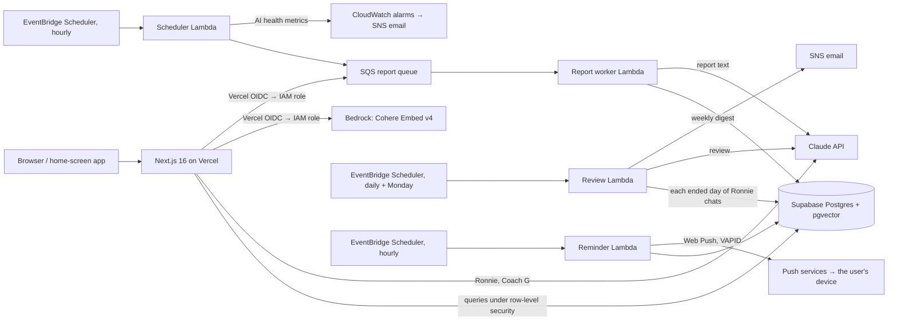

# GymPro

A workout tracker with an AI coach, in English and Traditional Chinese. It has three AI features, and an eval suite decides what ships in each:

- **Ronnie**: a coaching agent that works on the user's own training data.
- **Coach G**: a routine planner.
- **The weekly report**: a training review.

**Live:** [gympro.chichi.mom](https://gympro.chichi.mom). I log every workout in it.


## Highlights

- **An agent with guardrails.** Ronnie is a Claude tool-use agent with 14 tools over the user's data and a knowledge base of 151 papers.
  - Reads are free. A change to today's workout that the user names is made at once. A change Ronnie picks, and any change to a routine, is shown as a card, and code applies it when the user taps it.
  - Code writes every line that states a fact: memory receipts, plan summaries, corrections.
  - A reply that contradicts today's log is caught before it's shown.
- **Evals decide what ships.**
  - 99 scripted conversations against a fixture user, plus 146 search queries and 44 report scenarios.
  - Graded by code checks and an LLM judge.
  - Every run is recorded in the repo, and the model for each feature was chosen by eval.
  - Mistakes found in evals are replayed in CI on every pull request, at no cost.
- **Facts in code, words from the model.**
  - The weekly report's numbers and advice come from a rule table in code, backed by 27 cited papers whose DOIs are checked in CI. Code writes what to do next session on each lift; the model only phrases the rest.
  - Coach G's plan is built by code; a small model only reads the user's free text.
- **Measured, then tuned.**
  - Each page reports where its server time goes.
  - Tab switches went from 0.4–0.6 s to 0.16–0.33 s. The old and new data loaders were compared on 1,720 runs before the change shipped.
  - A CI check makes every write count, so a page never shows data from before the user's own change.
- **Production infrastructure in Terraform.**
  - Vercel and Supabase, with AWS for the report pipeline and the daily reminder: SQS, Lambda and EventBridge Scheduler.
  - No long-lived AWS keys.
  - 15 CloudWatch alarms. Every AI call is traced with its tokens and cost.
  - Every model call asks a spend limit first: one per user, and one for all users together.

## What it does

| | |
|---|---|
| **Log** | One set table for strength and cardio, with 8 log types, from weight × reps to treadmill and rower. Units are per exercise (kg or lb, km or mi). Each lift shows today's target, by the weekly report's own rule. There is also a daily note and body weight. |
| **Plan** | Routines, and a training cycle of 1 to 28 days that puts one on each day. A month calendar shows what's planned and what was done, and a day ahead can take another routine or become a rest day. |
| **Ronnie** | A chat coach. *"My elbow hurts, what instead of pushdowns?"*, *"What's left today?"*, *"Plan me a 4-day week."*, *"Will creatine make my hair fall out?"* It remembers injuries, likes and dislikes, equipment and schedule across conversations, and answers fitness questions from research notes, with the papers listed under the reply. |
| **Coach G** | The user answers a few questions and gets a week of routines built from a 190-exercise library, rated for muscles and joint load. |
| **Weekly report** | Made when the user's week ends, Monday to Sunday in their time zone. It shows the goal's progress, the key numbers and follow-up on last week's advice, then what to do next session on each lift, with the research behind each piece. A week under 10 working sets gets its numbers only, with no model call. |
| **Reminder** | At 9 PM in the user's time zone, a push notification asks "Did you train today?", except on a rest day. It is turned on in Settings. |
| **Layouts** | Separate phone and desktop layouts. On iPhone it installs to the home screen. |

<p>
  
  &nbsp;
  
</p>

The screenshots are from a demo account with made-up training ([`supabase/seed/demo_account.sql`](supabase/seed/demo_account.sql)). The report and Ronnie's replies in them are real model output.

## Architecture



- **App:** Next.js 16 on Vercel, in English and Traditional Chinese.
- **Data:** Supabase Postgres, with row-level security on every user table, and pgvector for search.
- **Reports:** an hourly scheduler queues each user's report when their week ends in their own time zone. A Lambda worker builds it, with retries and a dead-letter queue.
- **Reminders:** an hourly Lambda sends a Web Push to each user whose local time is 21:00.
- **AWS access:** Vercel assumes IAM roles through OIDC, and keys live in SSM Parameter Store. Everything AWS-side is in [`infra/terraform`](infra/terraform).

## More detail

| | |
|---|---|
| [What it does, in full](docs/features.md) | Every log type, the calendar's rules, the report's sections, the reminder's card |
| [How the AI parts are built](docs/ai.md) | Ronnie's tools, research notes, memory and reply checks; Coach G's planner; the weekly report's steps |
| [Evaluation](docs/evaluation.md) | Every eval suite, and every decision an eval made |
| [Architecture, CI, operations and security](docs/operations.md) | What CI checks, traces and flagged replies, the daily review, alarms, performance work, spend limits |

## Evaluation

- 99 scripted conversations against a fixture user (development, held out, knowledge, memory), 146 search queries and 44 report scenarios.
- Graded by code checks and an LLM judge (Claude Opus 5.5). Each case runs k times, and high-risk cases are reported as pass^k.
- Every run is recorded under [`.claude/hillclimb`](.claude/hillclimb). The runner refuses to start if the grader, cases or fixture changed since a human last approved them.
- Mistakes found in evals are replayed in CI on every pull request, at no cost.

Some of what the evals decided ([all of it](docs/evaluation.md)):

| Question | Measured | Decision |
|---|---|---|
| Which model for Ronnie? | Knowledge suite: Haiku 4.5 48%, Sonnet 5.5 88% | Sonnet 5.5 |
| Which model for reports? | Free-text reports: Haiku 4.5 23%, Sonnet 4.6 76% | Sonnet 4.6, then the facts moved into code |
| Which embeddings? | Held-out hit@5: keywords 75%, Titan V2 70%, Cohere Embed v4 90% | Cohere Embed v4, gated with keywords |
| Does a knowledge base make Ronnie better? | Judge 63/87 → 82/87; the right paper cited 0/63 → 60/63 | Shipped ([#78](https://github.com/Yung-Chi-Wu/gympro/pull/78)) |
| Ronnie called an exercise still to come "already done" | 5/8 → 8/8, with a code check instead of more prompt | The check is in code ([#62](https://github.com/Yung-Chi-Wu/gympro/pull/62)) |

## Performance

Each page reports where its server time goes, and a script times tab taps on production. Fewer database requests did most of it: Today went from 10 rounds of requests to one request. Tap to content, median of 6:

| Tab | Before | After |
|---|---|---|
| Today | 0.62–0.64 s | 0.25–0.29 s |
| Routines | 0.39–0.45 s | 0.21 s |
| History | 0.46–0.60 s | 0.33 s |
| Settings | 0.36–0.42 s | 0.16 s |

## Security

- Row-level security on every user table, with the policies in [`supabase/migrations`](supabase/migrations).
- No long-lived AWS credentials: production and preview deployments get separate IAM roles through OIDC.
- An enforced Content Security Policy. Anything it blocks is logged and raises an alarm.
- **AI spend limits** before every model call, against what OWASP's LLM10 calls "denial of wallet": one per user, one for new accounts, and one for all users together.
- Dependabot, GitHub Actions pinned to commit SHAs, and CodeQL on every pull request.

## Tech stack

| | |
|---|---|
| Frontend | Next.js 16, React 19, Tailwind CSS 4, next-intl, Recharts |
| Backend | Next.js route handlers and server actions, Supabase (Postgres, Auth, pgvector) |
| AI | Anthropic Claude (Sonnet 5.5, Sonnet 4.6, Haiku 4.5; Opus 5.5 as the eval judge), Cohere Embed v4 on Amazon Bedrock |
| AWS | Lambda, SQS, EventBridge Scheduler, CloudWatch, SNS, SSM Parameter Store, IAM OIDC, Budgets |
| Infrastructure as code | Terraform |
| CI | GitHub Actions |

## Repository layout

```
app/                 Next.js routes: pages, API handlers, server actions
components/          UI
lib/ronnie/          Ronnie: agent loop, tools, executor, memory, search, reply check
lib/coach-g*.ts      Coach G: request parsing and the code planner
lib/report/          Report evidence table, volume units, queue
lib/ai/              AI tracing, spend limits and the one place that makes a model client
lib/server-timing.ts Where each page's server time goes
lib/data-version.ts  The browser's data version: every write counts
lambda/ai-worker/    Report worker, hourly scheduler, daily review and reminders (Lambda), with their evals
evals/ronnie/        Ronnie evals: cases, fixture, grader, judge, runner, replays
evals/search/        Exercise search eval
infra/terraform/     AWS infrastructure
supabase/            Migrations, exercise attributes, seed data
scripts/             CI checks and data scripts
.claude/hillclimb/   Recorded eval runs, one folder per iteration
docs/                The detail behind this README, and its screenshots
```

## Running it locally

You need Node 22 (see `.nvmrc`), a Supabase project and an Anthropic API key.

```bash
npm ci
npm ci --prefix lambda/ai-worker   # esbuild and the worker's types, used by the scripts
```

Create `.env.local`:

```
NEXT_PUBLIC_SUPABASE_URL=...
NEXT_PUBLIC_SUPABASE_ANON_KEY=...
SUPABASE_SERVICE_ROLE_KEY=...
ANTHROPIC_API_KEY=...
```

Then run `npm run dev`.

- **Without AWS:** exercise search uses keywords only, and reports can't be queued. Those need the Terraform stack, and `AWS_ROLE_ARN`, `AWS_REGION` and `SQS_QUEUE_URL` on Vercel.
- **The database:** `supabase/migrations` holds the schema changes since October 2026. Each is one idempotent block. The base tables are older than the folder.

The free checks run as in CI: `npm run lint`, `npx tsc --noEmit`, `node evals/ronnie/check-replays.mjs`, and the `check:*` scripts in `package.json`.
